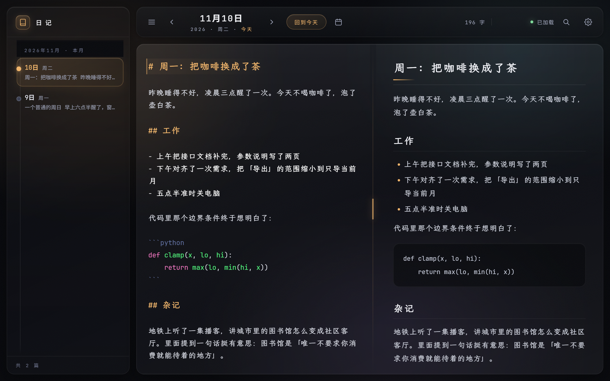
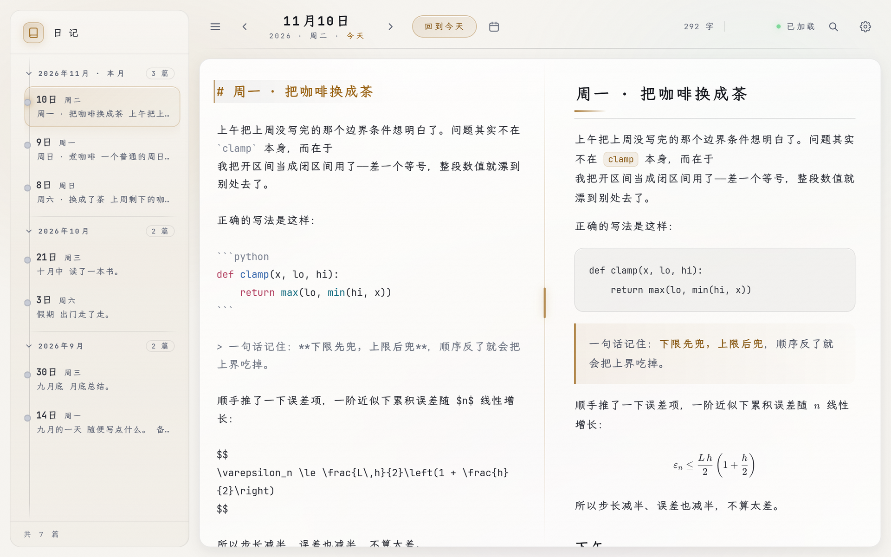
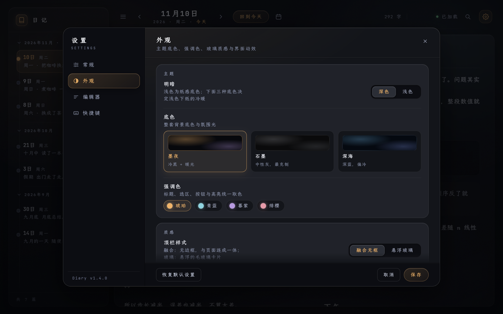
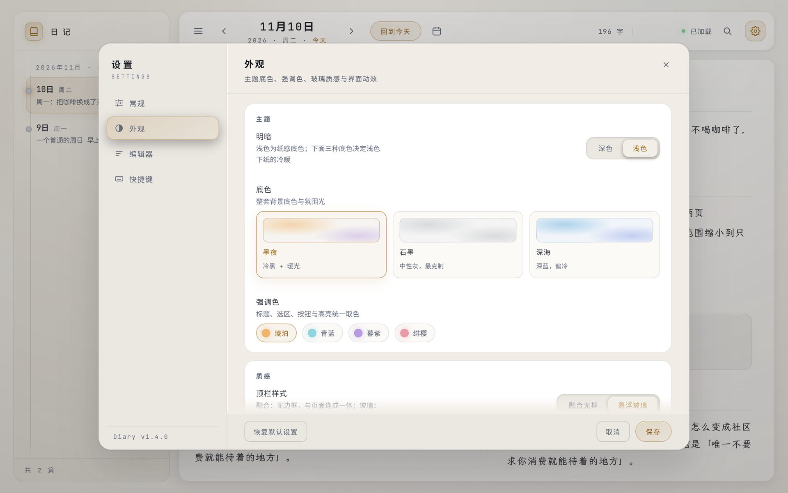
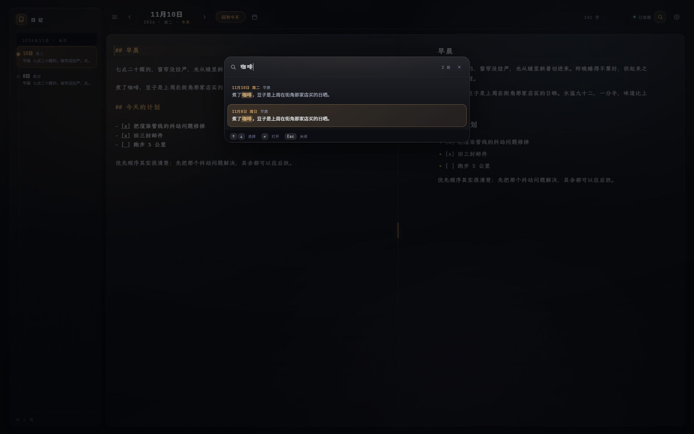
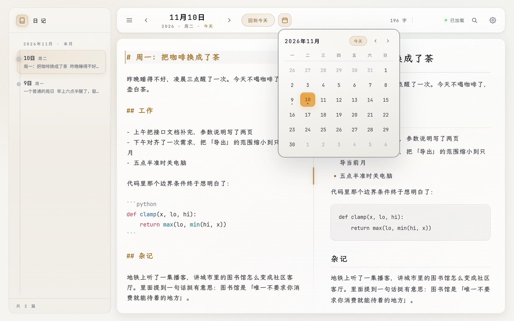
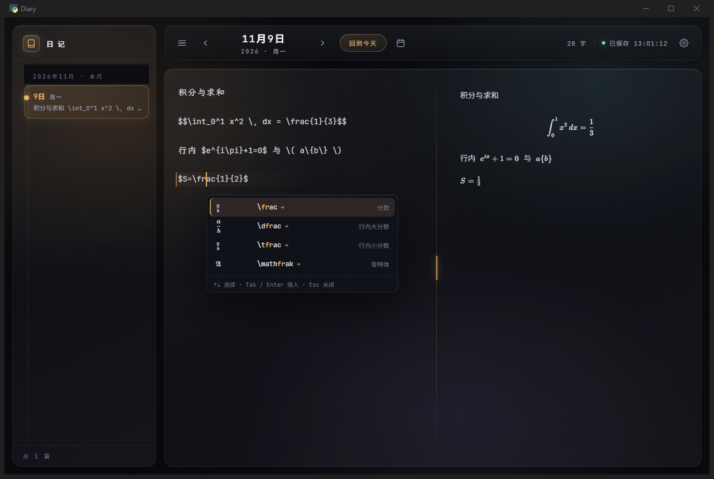
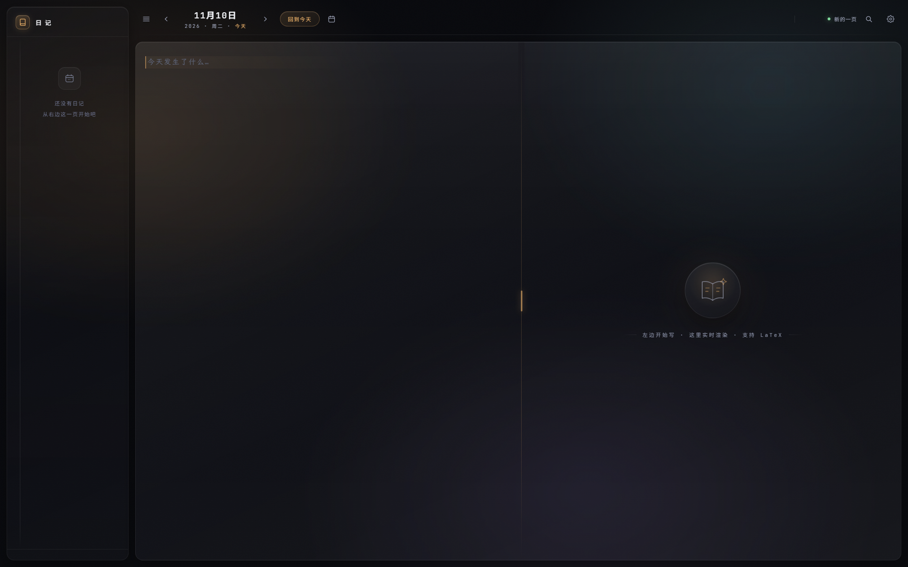
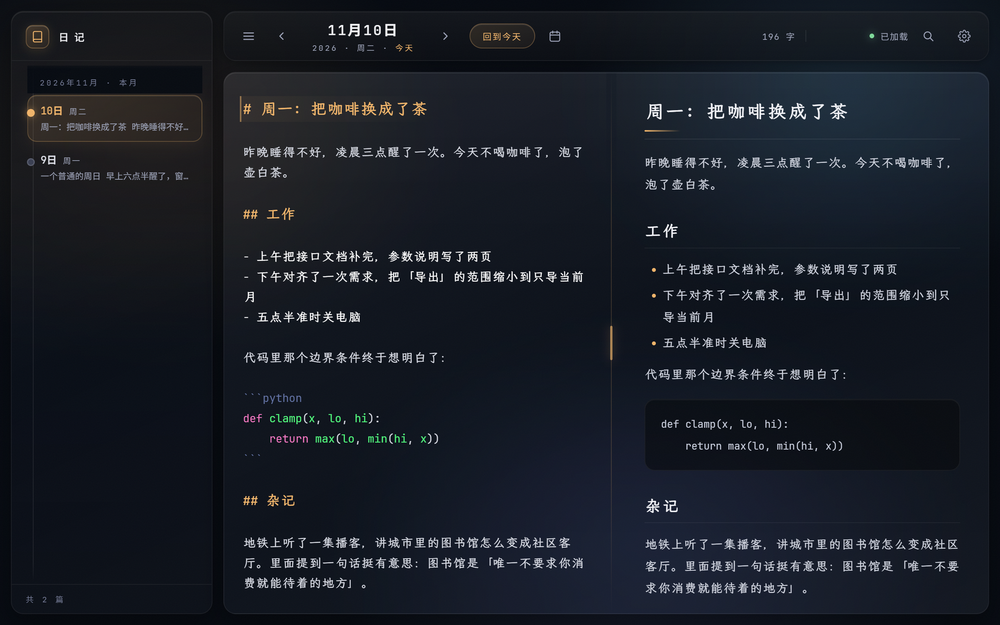
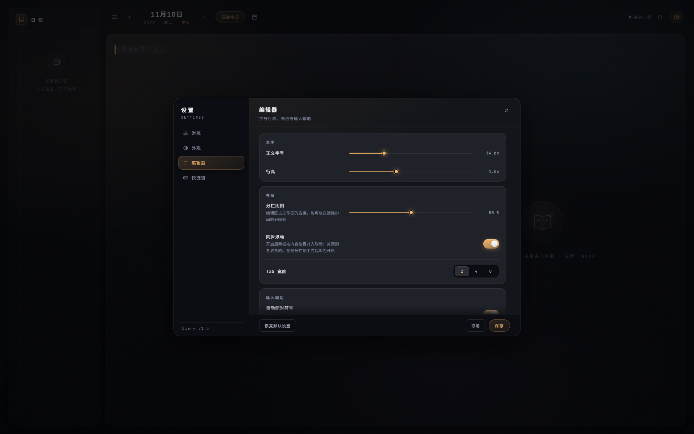

# Diary

> A local-first Markdown diary with live LaTeX, a hand-drawn glass calendar and two finely tuned themes.
> No account, no cloud, no telemetry — your entries stay as plain `.md` files on your disk.

<p align="center">
  
</p>

<p align="center">
  <a href="#features">Features</a> ·
  <a href="#screenshots">Screenshots</a> ·
  <a href="#quick-start">Quick start</a> ·
  <a href="#keyboard-shortcuts">Shortcuts</a> ·
  <a href="#how-it-works">How it works</a> ·
  <a href="#中文说明">中文说明</a>
</p>

---

## Why another diary app?

Most journaling apps want an account, a subscription, or a proprietary database. Diary goes the other
way: one file per day (`2026-11-10.md`), a native window on top of your local files, and a UI built
for the one thing you actually do — write a little, every day, and sometimes with maths in it.

It is a single-file Python server plus a vanilla-JS front end. No build step, no framework, no
`node_modules`. Edit `static/style.css`, hit refresh, done.

## Features

**Writing**
- Markdown editing with a live, side-by-side preview — and **synchronised scrolling** between the two panes
- **LaTeX that actually renders** while you type: `$...$` inline, `$$...$$` blocks, plus an inline
  autocomplete panel for commands (`\frac`, `\sum`, `\int`, …) with live KaTeX previews
- Math-first preview typography: formulas keep their size, spacing and line-height instead of being
  squeezed into the paragraph rhythm
- Markdown shortcuts, bracket/`$` auto-pairing, list continuation, autosave

**Finding things**
- Full-text search over every entry (`Ctrl+F`): a Spotlight-style panel that shows the date, the
  heading and the **sentence** that matched — press `Enter` to jump straight to it, with the sentence
  selected in the editor
- Sidebar list with excerpts, per-day dots in the calendar

**Looking at it**
- **Dark and light themes**, three paper colours each (Ink / Graphite / Ocean) and four accents —
  every combination is contrast-checked, not just tinted
- A five-step surface ladder (`--s1` … `--s5`) and a six-step radius scale, so panels, cards and
  wells actually read as different depths in both themes
- A glass calendar, Apple-flavoured motion (hover lift, press-in, spring transitions), optional
  aurora background and film grain

**Owning it**
- 100% local: the server binds `127.0.0.1` only, entries are plain text you can `grep`, `git`, or
  sync with anything
- Editable keyboard shortcuts, configurable diary directory, window geometry remembered
- No network calls at runtime; CodeMirror and KaTeX are vendored in `static/vendor`

## Screenshots

| Dark — main window | Light — main window |
| --- | --- |
|  |  |

| Settings (dark) | Settings (light) |
| --- | --- |
|  |  |

| Full-text search | Custom calendar |
| --- | --- |
|  |  |

| LaTeX autocomplete | Empty state |
| --- | --- |
|  |  |

| Ocean theme | Editor settings |
| --- | --- |
|  |  |

## Quick start

**Requirements** — Windows 10/11 with the WebView2 runtime (preinstalled on current Windows), Python 3.9+.

```bash
git clone https://github.com/Enkrid-Rao/diary.git
cd diary
pip install -r requirements.txt
python app.py
```

On first launch the app creates `diaries/` and `settings.json` next to `app.py`. Point the diary
folder somewhere else from **Settings → General** if you prefer.

> Want a single window with no console, plus a Start-menu shortcut? `Diary.py` is a thin launcher
> (loads `app.py` from the exe's folder so the code stays editable) and `gen_shortcut.py` creates the
> shortcut. Packaging into `Diary.exe` is optional — `pyinstaller --noconsole --onefile Diary.py`.
> This release ships source only.

## Keyboard shortcuts

Every shortcut is rebindable in **Settings → Shortcuts**.

| Action | Default | Action | Default |
| --- | --- | --- | --- |
| Save | `Ctrl+S` | Bold | `Ctrl+B` |
| Italic | `Ctrl+I` | Inline code | `Ctrl+E` |
| Strikethrough | `Ctrl+Shift+X` | Link | `Ctrl+K` |
| Full-text search | `Ctrl+F` | Settings | `Ctrl+,` |
| Previous / next day | `Alt+←` / `Alt+→` | Back to today | `Ctrl+T` |
| Toggle sidebar | `Ctrl+\` | Heading 1–3 | `Ctrl+1…3` |

Inside the search panel: `↑` `↓` to move, `Enter` to open, `Esc` to close.
Inside the LaTeX panel: `↑` `↓` to move, `Tab` / `Enter` to insert, `Esc` to close.

## How it works

```
app.py                  single-file HTTP server (stdlib http.server) + pywebview window
static/index.html       the whole UI, one page
static/style.css        design tokens + 19 sections; light theme lives in §19
static/app.js           editor, preview, calendar, search, settings
static/latex-*.js       command table + suggestion engine
static/vendor/          CodeMirror 5, KaTeX (vendored — no CDN, works offline)
diaries/YYYY-MM-DD.md   your entries (git-ignored)
settings.json           local config (git-ignored)
```

The server exposes a small JSON API (`/api/entry`, `/api/list`, `/api/search`, `/api/settings`) and
injects the saved settings into the page so the first frame already has the right theme — no flash.

### Notes on the design

The palette is built on **surface steps, not shadows**. Dark mode raises elements by *brightening*
them in small, even steps; light mode does the same thing in the opposite direction — page darkest,
dialog slightly whiter, cards pure white — rather than inverting the dark theme, which only ever
produces dirty grey. Accent colours are split in two: `--accent` (deepened, for text and borders,
AA-contrast) and `--accent-fill` (kept saturated, for switches, sliders and the selected day).

## License

No license file yet — if you plan to reuse the code, open an issue and I'll add one.

---

# 中文说明

> 本地优先的 Markdown 日记：实时 LaTeX、自绘玻璃日历、深色与浅色两套主题。
> 不要账号、不走云端、没有遥测——每一篇日记就是一个 `.md` 文件，躺在你自己的硬盘上。

## 为什么又写一个日记应用

大多数日记应用要求你注册账号、订阅、或者把内容塞进它自己的数据库。Diary 反过来：一天一个文件
（`2026-11-10.md`），一个原生窗口直接压在你的文件夹上，界面只为一件事服务——每天写一点，偶尔还
要写点公式。

技术上它就是一个 Python 单文件服务器加一坨原生 JS：**没有构建步骤、没有框架、没有 node_modules**。
改 `static/style.css`、刷新，就完事。

## 功能

**写作**
- Markdown 编辑 + 右侧实时预览，两栏**联动滚动**
- **LaTeX 边打边渲染**：行内 `$...$`、块级 `$$...$$`；输入 `\` 弹出命令补全面板（`\frac`、`\sum`、
  `\int` …），每项带真实的 KaTeX 预览
- 预览"数学优先"排版：公式保留自己的字号、间距与行高，不被正文节奏挤扁
- Markdown 快捷键、括号与 `$` 自动配对、列表续行、自动保存

**找东西**
- 全文搜索（`Ctrl+F`）：Spotlight 式面板，逐条列出「日期 + 小标题 + 命中的那句话」，
  `Enter` 直接跳到那篇日记，并在编辑器里选中命中句
- 侧栏按天列出摘要；日历上有写作记录的小圆点

**看起来**
- **深色 / 浅色**两套主题，各三张纸色（墨夜 / 石墨 / 深海）、四种强调色——每种组合都核算过对比度，
  不是简单换个色相
- 五级表面色阶（`--s1…--s5`）与六档圆角，两种主题下"哪层更靠前"都读得出来
- 玻璃日历、Apple 味的手感（悬停抬起、按下压回、弹簧过渡），可选的极光底色与胶片颗粒

**归你所有**
- 全本地：服务只监听 `127.0.0.1`，日记是纯文本，`grep`、`git`、任意同步工具都能用
- 快捷键可自定义、日记目录可改、窗口位置会记住
- 运行时不联网；CodeMirror 与 KaTeX 已内置在 `static/vendor`

## 快速开始

**环境** — Windows 10/11（自带 WebView2 运行时）、Python 3.9+。

```bash
git clone https://github.com/Enkrid-Rao/diary.git
cd diary
pip install -r requirements.txt
python app.py
```

首次启动会在 `app.py` 同级创建 `diaries/` 与 `settings.json`。想把日记放别处，去
**设置 → 常规 → 日记目录** 改。

## 快捷键

全部可在 **设置 → 快捷键** 里改绑，默认值与上表一致。

## 设计说明

配色建立在**表面色阶**上，而不是阴影——深色模式靠"提亮"分级，浅色模式同方向往白里抬
（页面最暗、面板略白、卡片纯白），而不是把深色反相（反相只会得到一堆脏白）。强调色拆成两支：
`--accent` 压深后给文字与描边（AA 对比），`--accent-fill` 保持饱和给开关、滑块、选中日期。
