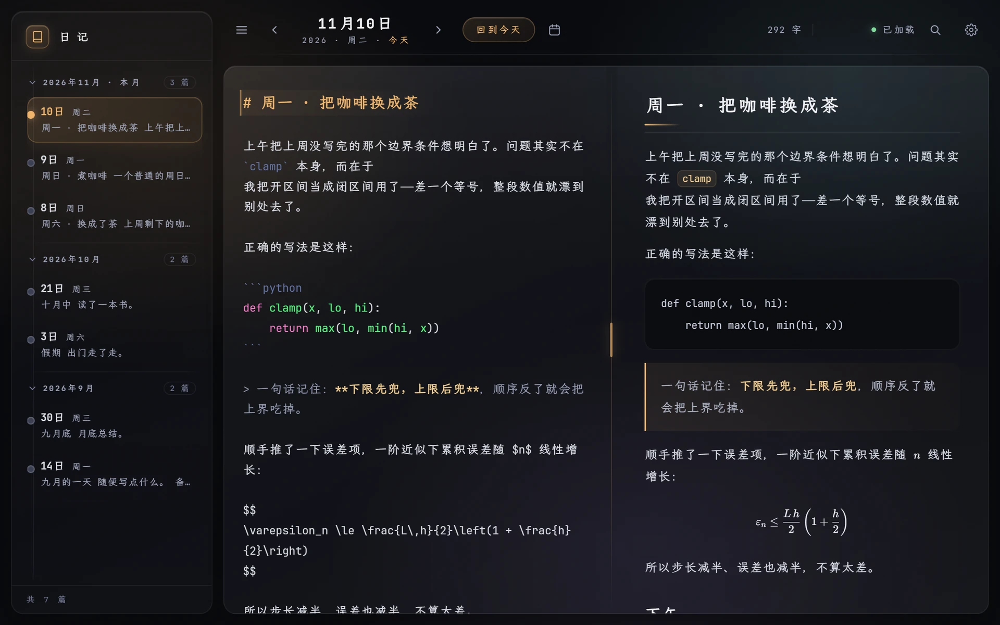
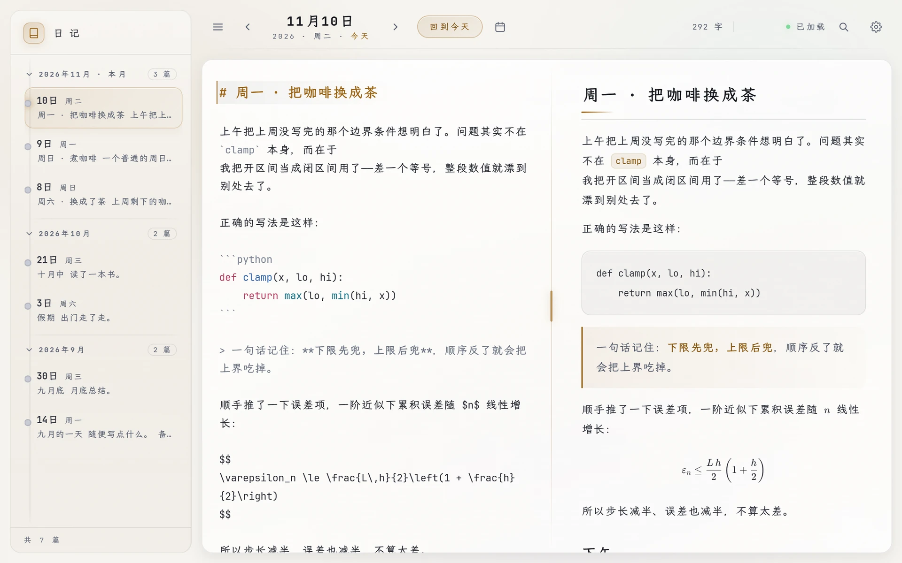
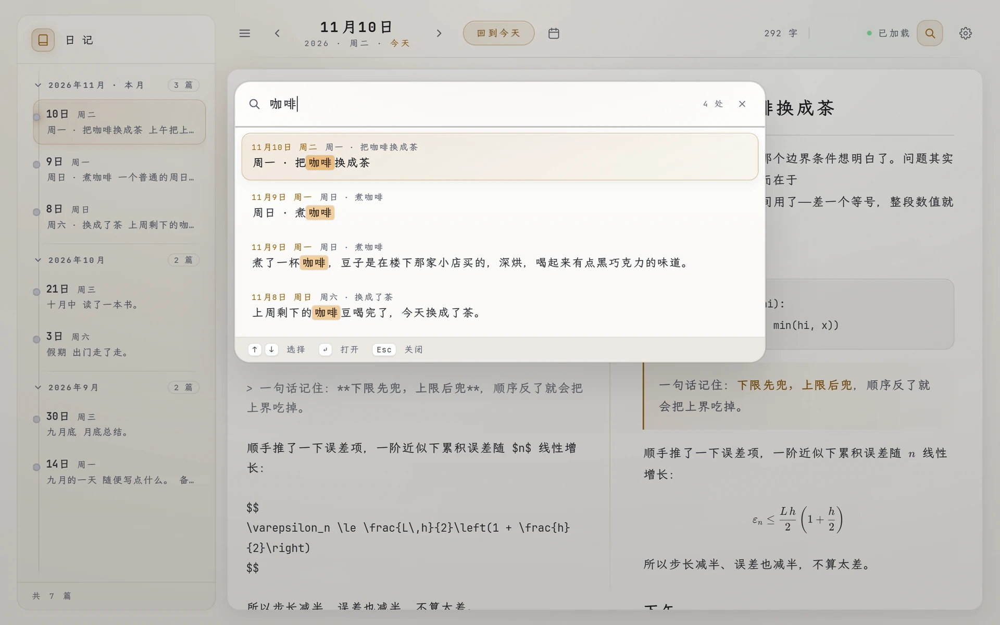
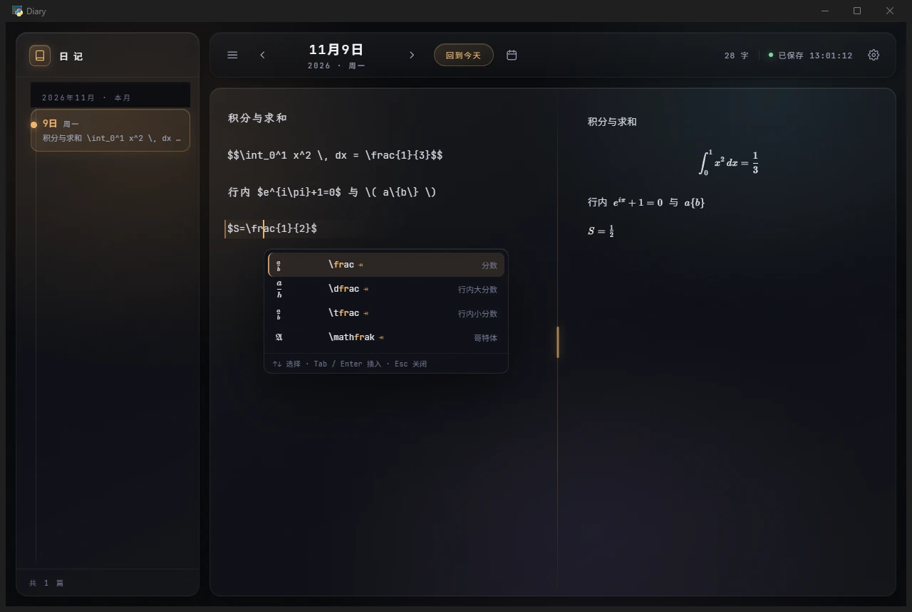
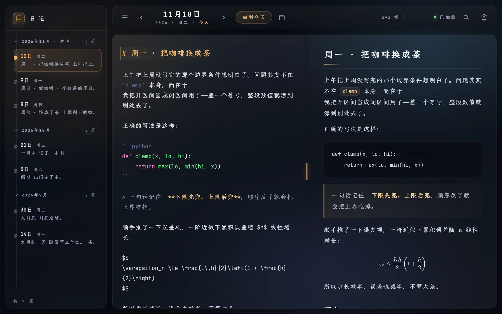
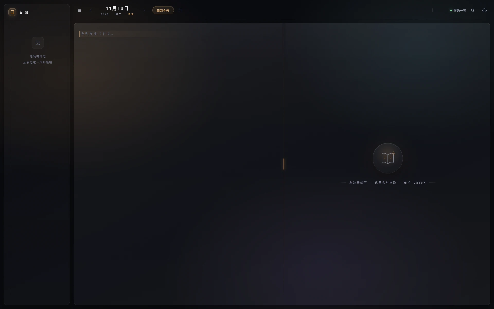
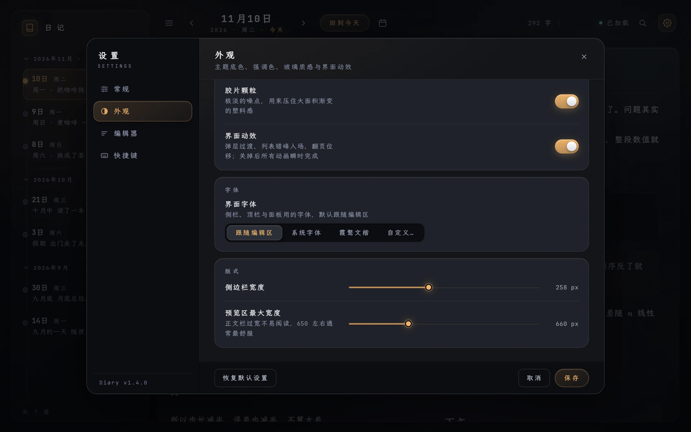

# Diary

**本地优先的 Markdown 日记** —— 实时 LaTeX、全文搜索、自绘玻璃日历，以及两套完整的主题。

不要账号、不走云端、没有遥测。一天一个 `.md` 文件，躺在你自己的硬盘上。

<p align="center">
  <a href="https://github.com/Enkrid-Rao/diary/releases"></a>
  <a href="#快速开始"></a>
  <a href="#快速开始"></a>
  <a href="LICENSE"></a>
  <a href="https://github.com/Enkrid-Rao/diary/stargazers"></a>
  <a href="README.md"></a>
  
</p>

<p align="center">
  <a href="docs/01-main-flat.webp"></a>
</p>

<p align="center">
  <a href="#功能">功能</a> ·
  <a href="#截图">截图</a> ·
  <a href="#快速开始">快速开始</a> ·
  <a href="#快捷键">快捷键</a> ·
  <a href="#项目结构">项目结构</a> ·
  <a href="#许可">许可</a> ·
  <a href="README.md">English</a>
</p>

---

## 为什么又写一个日记应用

大多数日记应用要求你注册账号、订阅、或者把内容塞进它自己的数据库。Diary 反过来：一天一个文件
（`2026-11-10.md`），一个原生窗口直接压在你的文件夹上，界面只为一件事服务——每天写一点，偶尔还
要写点公式。

技术上它就是一个 Python 单文件服务器加一坨原生 JS：**没有构建步骤、没有框架、没有 node_modules**。
改 `static/style.css`、刷新，就完事。

<p align="center">
  <b><a href="https://github.com/Enkrid-Rao/diary/releases/latest">下载 Windows 版</a></b>
  &nbsp;·&nbsp; 安装包（.exe）或绿色版（.zip），不需要装 Python
</p>

## 功能

**写作**
- Markdown 编辑 + 右侧实时预览，两栏**联动滚动**
- **LaTeX 边打边渲染**：行内 `$...$`、块级 `$$...$$`；输入 `\` 弹出命令补全面板（`\frac`、`\sum`、
  `\int` …），每项带真实的 KaTeX 预览
- 预览"数学优先"排版：公式保留自己的字号、间距与行高，不被正文节奏挤扁
- Markdown 快捷键、括号与 `$` 自动配对、列表续行、自动保存

**找东西**
- 全文搜索（`Ctrl+F`）：Spotlight 式面板，逐条列出「日期 + 小标题 + 命中的那句话」，
  `Enter` 直接跳到那篇日记，并在编辑器里选中命中句
- 侧栏**按月分组**，点组头即可折叠 / 展开，折叠状态会被记住
- 日历支持跳转：点日历上的月份标题，输入 `YYYY-MM-DD`，`Enter` 直达那一天

**看起来**
- **深色 / 浅色**两套主题，各三张纸色（墨夜 / 石墨 / 深海）、四种强调色——每种组合都核算过对比度，
  不是简单换个色相
- **自定义字体**：界面字体与编辑器字体分开设置——跟随编辑区 / 跟随系统 / 霞鹜文楷 / 自定义（填本机
  已安装的字体名，可逗号分隔多个）；编辑器字体是全局默认
- 五级表面色阶（`--s1…--s5`）与六档圆角，两种主题下"哪层更靠前"都读得出来
- 玻璃日历、Apple 味的手感（悬停抬起、按下压回、弹簧过渡），可选的极光底色与胶片颗粒

**归你所有**
- 全本地：服务只监听 `127.0.0.1`，日记是纯文本，`grep`、`git`、任意同步工具都能用
- 快捷键可自定义、日记目录可改、窗口位置会记住
- 默认不联网；只有打开「自动检查更新」才会访问 GitHub，其余情况一个请求都不发。
  CodeMirror 与 KaTeX 已内置在 `static/vendor`
- 自动更新默认关闭：打开后启动时与每 6 小时查一次 GitHub Release，下载安装包并校验
  （体积 + MZ 头），交给安装器时也不会上传任何日记内容

## 截图

> 点任意图片可放大查看；更多见 [`docs/`](docs)。

<table>
  <tr>
    <td width="50%" align="center">
      <a href="docs/01-main-flat.webp"></a><br>
      <sub><b>深色 · 墨夜</b> —— 编辑器与实时预览</sub>
    </td>
    <td width="50%" align="center">
      <a href="docs/11-light-main.webp"></a><br>
      <sub><b>浅色 · 墨夜</b> —— 同一页的纸白版本</sub>
    </td>
  </tr>
  <tr>
    <td width="50%" align="center">
      <a href="docs/10-search.webp"></a><br>
      <sub><b>全文搜索</b> —— 日期、小标题、命中的那句话</sub>
    </td>
    <td width="50%" align="center">
      <a href="docs/13-light-search.webp"></a><br>
      <sub><b>全文搜索</b> —— 命中词是荧光笔块</sub>
    </td>
  </tr>
  <tr>
    <td width="50%" align="center">
      <a href="docs/03-settings-appearance.webp"></a><br>
      <sub><b>设置 · 外观</b> —— 三张纸 × 四支强调色</sub>
    </td>
    <td width="50%" align="center">
      <a href="docs/12-light-settings.webp"></a><br>
      <sub><b>设置 · 外观</b> —— 栏 / 页 / 卡片三级阶梯</sub>
    </td>
  </tr>
  <tr>
    <td width="50%" align="center">
      <a href="docs/14-light-calendar.webp"></a><br>
      <sub><b>日历</b> —— 自绘玻璃，有记录的日期带点</sub>
    </td>
    <td width="50%" align="center">
      <a href="docs/07-latex-hint.webp"></a><br>
      <sub><b>LaTeX 补全</b> —— 每一行左边都是真实的 KaTeX 渲染</sub>
    </td>
  </tr>
  <tr>
    <td width="50%" align="center">
      <a href="docs/06-ocean-glass.webp"></a><br>
      <sub><b>深海</b> —— 偏冷的第三张纸</sub>
    </td>
    <td width="50%" align="center">
      <a href="docs/09-empty-state.webp"></a><br>
      <sub><b>空状态</b> —— 还没写东西时的那一页</sub>
    </td>
  </tr>
</table>

<p align="center">
  <a href="docs/15-settings-font.webp"></a><br>
  <sub><b>设置 · 字体</b> —— 界面字体与编辑器字体分开设置，也可以填本机任意已安装的字体名</sub>
</p>

## 快速开始

**方式一：直接安装。** 不需要装 Python。下载最新的
[`Diary-*-win64-setup.exe`](https://github.com/Enkrid-Rao/diary/releases/latest) 双击运行即可：
只支持 Windows 10/11，现行系统自带 WebView2。日记写在 `文档\Diary`，设置写在 `%APPDATA%\Diary`，
升级和卸载都不会动它们。安装向导默认装到 `C:\Program Files\Diary`，也可以选「只为我安装」，
那样会落到 `%LOCALAPPDATA%\Programs\Diary`。

**方式二：绿色版。** 下载 `.zip`，解压到任意目录，双击 `Diary.exe`。日记就在 exe 旁边，
整个文件夹可以扔进 U 盘带走。

**方式三：从源码运行。** Windows 10/11（自带 WebView2 运行时）、Python 3.9+。

```bash
git clone https://github.com/Enkrid-Rao/diary.git
cd diary
pip install -r requirements.txt
python app.py
```

首次启动会在 `app.py` 同级创建 `diaries/` 与 `settings.json`。想把日记放别处，去
**设置 → 常规 → 日记目录** 改。

> 想和已安装的版本同时开着？默认端口是 17823，第二个实例换个端口即可：
> `DIARY_PORT=17824 python app.py`。

> **自己打包：** `python build_release.py` 用 PyInstaller 出绿色版目录与 zip；`installer.iss` 用
> Inno Setup 6 编译安装包；`Diary.py` 仍是最薄的启动器，用来在可编辑的源码上跑一个 exe。

## 快捷键

全部可在 **设置 → 快捷键** 里改绑，默认值与下表一致。

| 操作 | 默认 | 操作 | 默认 |
| --- | --- | --- | --- |
| 保存 | `Ctrl+S` | 加粗 | `Ctrl+B` |
| 斜体 | `Ctrl+I` | 行内代码 | `Ctrl+E` |
| 删除线 | `Ctrl+Shift+X` | 链接 | `Ctrl+K` |
| 全文搜索 | `Ctrl+F` | 设置 | `Ctrl+,` |
| 前一天 / 后一天 | `Alt+←` / `Alt+→` | 回到今天 | `Ctrl+T` |
| 收起侧栏 | `Ctrl+\` | 一至三级标题 | `Ctrl+1…3` |

搜索面板内：`↑` `↓` 移动、`Enter` 打开、`Esc` 关闭。
LaTeX 面板内：`↑` `↓` 移动、`Tab` / `Enter` 插入、`Esc` 关闭。

## 项目结构

```
app.py                  单文件 HTTP 服务（stdlib http.server）+ pywebview 窗口
static/index.html       整个界面，就一页
static/style.css        设计变量 + 19 个小节；浅色主题在 §19
static/app.js           编辑器、预览、日历、搜索、设置
static/latex-*.js       命令表 + 补全建议引擎
static/vendor/          CodeMirror 5、KaTeX（已内置，无 CDN，离线可用）
diaries/YYYY-MM-DD.md   你的日记（已 git 忽略）
settings.json           本地配置（已 git 忽略）
```

服务端暴露一组很小的 JSON API（`/api/entry`、`/api/list`、`/api/search`、`/api/settings`），并把已保存
的设置直接注入页面，所以第一帧就是正确的主题——不会闪一下。

### 设计说明

配色建立在**表面色阶**上，而不是阴影——深色模式靠"提亮"分级，浅色模式同方向往白里抬
（页面最暗、面板略白、卡片纯白），而不是把深色反相（反相只会得到一堆脏白）。强调色拆成两支：
`--accent` 压深后给文字与描边（AA 对比），`--accent-fill` 保持饱和给开关、滑块、选中日期。

## 许可

[MIT](LICENSE) © 2026 XinxingRao —— 随便用、随便改、随便发。
